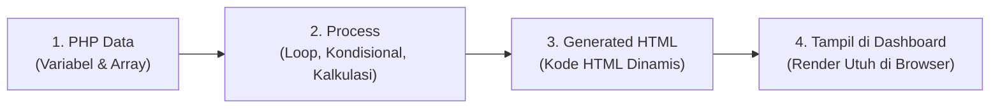

# VIP Bespoke Travel - Client Portal & Travel Planning Dashboard

- **Pengembang / Identitas:** Bagas Dewantara (NIM: 202410370110441)
- **Branch:** `Bagas-Dewantara-202410370110441`
- **Repository:** [VIP-Bespoke-Travel](https://github.com/BagasD-Tara/VIP-Bespoke-Travel.git)

---

## 🚀 Fitur & Pekerjaan yang Telah Diselesaikan

### 1. Autentikasi Pengguna & Keamanan (JWT & Bcrypt)

- **Halaman Login Interaktif (`public/login.html`, `public/login.js`)**:
  - Validasi input email dan kata sandi di sisi _client_ dan _server_.
  - Penyimpanan token JWT ke _localStorage_ dengan penanganan sesi otomatis.
  - Penanganan pesan _error_ autentikasi dan status loading pada tombol submit.
- **Keamanan Backend (`server.js`, `hash-password.js`)**:
  - Penyimpanan kata sandi terenkripsi menggunakan algoritma `bcryptjs`.
  - Endpoint `POST /api/auth/login` dengan respon token berstandar JWT (_JSON Web Token_).
  - Middleware proteksi `requireAuth` dengan skema `Bearer Token` untuk rute-rute privat (`/api/profile`).
  - Script pembantu enkripsi password pengguna (`npm run hash`).

### 2. VIP Client Dashboard Terintegrasi API (`src/dashboard.ts`, `public/dashboard.html`)

- **Implementasi TypeScript Type-Safe (`src/types.ts`)**:
  - Definisi interface lengkap untuk struktur data API: `Customer`, `Business`, `TravelRequest`, `ActionItem`, `UpcomingTrip`, `MessageItem`, dan `DashboardData`.
  - Definisi state generic `ApiState<T>` (`idle`, `loading`, `success`, `error`) untuk kontrol aliran data yang ketat dan bebas _bug_.
- **Koneksi REST API & Pengambilan Data (`GET /api/dashboard`)**:
  - Mengambil data profil klien, status permintaan perjalanan, daftar tindakan mendesak (_Perlu Tindakan_), jadwal perjalanan mendatang (_Upcoming Trip_), serta pesan dari travel advisor.
  - Mendukung pembacaan header authorization Bearer Token untuk personalisasi nama pengguna secara dinamis.
- **Handling API State & Umpan Balik Visual**:
  - Indikator status loading (_spinner_ & animasi rotasi tombol refresh).
  - Penanganan kegagalan API (_error state_) dengan pesan jelas dan tombol coba lagi (_Retry_).
  - Tombol **Refresh Dashboard** untuk memperbarui data secara asinkron tanpa _reload_ halaman penuh.
  - Sistem **Toast Notification** mengambang (_Floating Toast_) dengan ragam status (`success`, `error`, `info`, `warning`) dan auto-dismiss.

### 3. Formulir Pengajuan Perjalanan Baru (Interactive Modal Form)

- **Modal Request Perjalanan Baru**:
  - Modal interaktif yang dapat dibuka/tutup dengan tombol atau tombol _Cancel_ / _Esc_.
  - Form mencakup input: Destinasi tujuan, rentang tanggal perjalanan, jumlah tamu/rombongan, dan catatan kebutuhan khusus.
- **Integrasi API Pembuatan Request (`POST /api/requests`)**:
  - Validasi data di backend dengan pembuatan ID unik dan inisialisasi tahap pelacakan perjalanan (_step tracker_).
  - Pembaruan file data persistensi `dashboard-data.json`.
  - Auto-refresh daftar permintaan secara instan setelah data berhasil dikirim, disertai notifikasi sukses.

### 4. Halaman Pendukung & Desain UI/UX

- **Landing Page (`public/landing_page.html`)**: Halaman beranda yang memperkenalkan portofolio paket liburan mewah, kurasi destinasi, dan tombol navigasi langsung ke portal login.
- **Halaman Profil Klien (`public/profile.html`, `public/profile.js`)**: Halaman detail akun pengguna yang terproteksi oleh token sesi, menampilkan informasi identitas akun klien.
- **Desain Mewah & Responsif (`public/dashboard.css`, `public/style.css`)**:
  - Tata letak responsif (_mobile, tablet, desktop_).
  - Tipografi dan palet warna elegan bertema _luxury concierge_.
  - Step tracker dinamis yang menunjukkan progres pengajuan proposal (_Diajukan_ ➔ _Ditinjau_ ➔ _Proposal_ ➔ _Disetujui_ ➔ _Dikonfirmasi_).

### 5. Konfigurasi Lingkungan & Tooling

- **Kompilasi TypeScript**: Mengonfigurasi `tsconfig.json` untuk mengompilasi TypeScript dari `src/dashboard.ts` menjadi bundle JavaScript `public/dashboard.js`.
- **Manajemen Variabel Lingkungan (`.env`)**: Pengaturan port server dan `JWT_SECRET` yang fleksibel dan aman.
- **Pembersihan & Pengaturan Git**: Pemisahan repositori dari _nested git/submodule_, pengabaian berkas sensitif lewat `.gitignore` (_node_modules_, _.env_, build artifacts).

### 6. Implementasi VIP Dashboard Berbasis PHP (Server-Side Rendering / SSR)

- **Konversi & Pembuatan `public/dashboard.php`**:
  - Mengimplementasikan konsep Server-Side Rendering (SSR) di mana skrip PHP dieksekusi di server untuk mengolah data dan menghasilkan kode HTML utuh sebelum dikirimkan ke peramban.
  - Mempertahankan 100% tata letak dan estetika mewah (_luxury concierge_) dari `dashboard.html`, termasuk tipografi Google Fonts (_Cormorant Garamond_ & _Manrope_), Tailwind CSS, dan stylesheet kustom `dashboard.css`.
- **Integrasi & Pengolahan Data Dinamis PHP**:
  - Mengambil data dari `dashboard-data.json` dengan mekanisme proteksi _fallback array_ bawaan PHP jika file tidak ditemukan.
  - Menggunakan fungsi keamanan `htmlspecialchars()` untuk sanitasi seluruh output dan pencegahan celah keamanan XSS (_Cross-Site Scripting_).
  - Iterasi dinamis komponen UI menggunakan perulangan PHP (`foreach` dan pengondisian):
    - **Header & Greeting:** Menampilkan nama klien terdaftar dan status badge `PHP SSR Aktif`.
    - **Perlu Tindakan Anda:** Iterasi kartu proposal (badge emas & tombol aksi) dan review status (badge mint).
    - **Request Saya:** Pelacakan tahapan perjalanan (_5-Step Progress Bar_: _Diajukan_ ➔ _Ditinjau_ ➔ _Proposal_ ➔ _Disetujui_ ➔ _Dikonfirmasi_) serta ringkasan estimasi biaya dan status booking.
    - **Perjalanan Mendatang:** Kartu jadwal keberangkatan (_date tile_ tanggal & bulan) dan ringkasan konfirmasi.
    - **Pesan Terbaru:** Percakapan concierge terkini (_avatar initial_, pengirim, waktu relatif, dan cuplikan pesan).
- **Penanganan Formulir Sisi Server (Server-Side Form Processing)**:
  - Form modal pengajuan perjalanan baru (`+ Buat Request Baru`) terhubung via metode HTTP `POST` langsung ke `dashboard.php`.
  - Validasi input destinasi, tanggal, dan jumlah tamu di sisi server PHP.
  - Penambahan otomatis request baru ke daftar array perjalanan dan penyimpanan persistensi ke `dashboard-data.json`.
  - Umpan balik visual interaktif berupa _Flash Notification Alert_ (status sukses/gagal) yang dapat ditutup (_dismissible_).
- **Navigasi Cepat Antar Arsitektur (SSR vs CSR)**:
  - Tautan transisi di sidebar untuk berpindah antara versi **PHP (Server-Side Rendering)** dan versi **HTML + JS (Client-Side Rendering via REST API)**.
- **Tooling & Dukungan Server Lokal**:
  - Penambahan npm script `php:serve` di `package.json` yang secara otomatis memanfaatkan binary PHP 8.1 dari instalasi XAMPP macOS (`/Applications/XAMPP/xamppfiles/bin/php -S localhost:8000 -t public`).

### 7. Task 2 Week 5: Pemrosesan Data Server-Side dengan PHP Sebelum Ditampilkan (PHP Data Processing Layer)

> **Penugasan:** ✅ **Task 2 Week 5**
>
> **Deskripsi Tugas:** Menggunakan PHP untuk memproses data sebelum ditampilkan pada halaman dashboard (validasi, agregasi portofolio anggaran, kalkulasi durasi, hitung mundur keberangkatan, serta filter & pencarian sisi server).

- **Pemisahan Logika & Pemrosesan Data Modular (`public/data-processor.php`)**:
  - Memisahkan secara tegas logika bisnis, kalkulasi data, dan penataan format (Data Processing Layer) dari template antarmuka HTML (View SSR), mengikuti prinsip _Separation of Concerns_.
- **Kalkulasi & Agregasi Metrik Portofolio VIP (KPI Dashboard Cards)**:
  - **Total Permintaan Perjalanan:** Menghitung total seluruh request serta agregasi status aktif vs selesai (`totalRequests`, `activeRequests`, `confirmedRequests`).
  - **Akumulasi Total Anggaran (Budget Calculator):** Mengekstrak nilai numerik dari string biaya (misal `"Rp 145.000.000"` ➔ `145000000`), menjumlahkan total anggaran portofolio klien, dan memformat kembali ke standar mata uang Rupiah (`formatRupiah()`).
  - **Hitung Mundur Hari Keberangkatan (Days Countdown):** Menghitung selisih hari menuju jadwal perjalanan terdekat secara otomatis dari objek tanggal (`DateTime`) server PHP (misal `"29 Hari Lagi"`).
  - **Indikator Tindakan Menunggu:** Mengkalkulasi counter jumlah item yang membutuhkan persetujuan klien (`pendingActionsCount`).
- **Manipulasi Waktu & Durasi Perjalanan Dinamis**:
  - **Kalkulator Durasi Hari & Malam:** Mengekstrak dan memproses rentang tanggal (misal `"18 Nov – 25 Nov 2026"`) menjadi durasi nyata perjalanan (`"8 Hari • 7 Malam"`).
  - **Sapaan Cerdas Berbasis Waktu Server (Time-of-Day Greeting):** Menampilkan sapaan dinamis berdasarkan jam lokal server Asia/Jakarta (_Selamat Pagi_, _Selamat Siang_, _Selamat Sore_, _Selamat Malam_).
  - **Normalisasi Waktu Relatif:** Memperhalus waktu pesan concierge (misal `"10m lalu"` ➔ `"10 menit yang lalu"`).
- **Transformasi Visual & Identitas Klien**:
  - **Generator Inisial Avatar Dinamis:** Menghasilkan inisial nama klien dan concierge secara otomatis (misal `"Dragon"` ➔ `"DR"`, `"Michael (Concierge)"` ➔ `"MC"`).
  - **Klasifikasi Status Perjalanan:** Memetakan status perjalanan dan persentase penyelesaian tahapan progress bar secara dinamis.
- **Penyaringan & Pencarian Sisi Server (Server-Side Filtering & Search)**:
  - Filter kategori cepat via query URL (`?filter=all`, `?filter=proposal`, `?filter=confirmed`).
  - Fitur pencarian kata kunci destinasi/tanggal via parameter GET (`?q=...`) yang diproses langsung oleh fungsi `array_filter()` dan `stripos()` di PHP sebelum daftar perjalanan dirender ke browser.

### 8. Task 3 Week 5: Generasi Konten Halaman Dashboard Dinamis oleh PHP (4-Stage Pipeline)

> **Penugasan:** ✅ **Task 3 Week 5**
>
> **Deskripsi Tugas:** Membuat seluruh bagian halaman dashboard dihasilkan secara dinamis oleh PHP (bukan ditulis satu per satu secara manual), mengikuti alur 4 tahap proses:
> 1. **PHP Data:** Data program disimpan dalam variabel / array.
> 2. **Process:** Data diproses oleh PHP (seperti loop, conditional, kalkulasi, dan manipulasi data).
> 3. **Generated HTML:** PHP menghasilkan kode struktur HTML secara dinamis berbasis data hasil proses.
> 4. **Konten Tampil di Dashboard:** Konten-konten hasil generate tampil utuh, responsif, dan interaktif pada halaman dashboard di browser.

#### Diagram Alur Pemrosesan 4 Tahap:



#### Tabel Komparasi: Penulisan Manual vs Generasi Dinamis PHP

| Bagian Dashboard | Implementasi Manual Sebelumnya | Implementasi Dinamis PHP (Task 3 Week 5) |
| :--- | :--- | :--- |
| **Navigasi Sidebar** | 5 link `<a class="nav-link">` ditulis copas manual satu per satu | Di-generate dari array `$sidebarNavData` via perulangan `foreach` & kondisional class `active` |
| **Kartu Metrik KPI (4 Kartu)** | 4 blok kartu statistik di-hardcode manual di HTML (~80 baris tag) | Di-generate dari array `$kpiCards` via `foreach` & pemilihan tema warna via `match($theme)` |
| **Filter Tab (3 Kategori)** | 3 tombol filter ditulis manual satu per satu di template | Di-generate dari array `$filterTabs` via `foreach` dengan seleksi kondisional status aktif |
| **Perlu Tindakan Anda** | Kartu tindakan disalin statis di template HTML | Di-generate dinamis via `foreach ($perluTindakan as $item)` dengan logika kondisional `proposal` vs `review` |
| **Request Perjalanan** | Kartu perjalanan dan progress bar ditulis manual | Di-generate dinamis via `foreach ($requestSaya as $req)` dengan *nested loop* 5 tahapan progress bar |
| **5-Step Progress Bar** | 5 bar status ditulis manual per kartu request | *Nested loop* `foreach ($steps as $idx => $step)` dengan penanda warna kondisional (`$idx <= $currentIndex`) |
| **Perjalanan Mendatang** | Widget kalender dan status diisi manual | Logika kondisional ketersediaan agenda & hitung mundur dinamis via objek `DateTime` PHP |
| **Pesan Terbaru** | Cuplikan pesan di-hardcode manual | Di-generate dinamis via `foreach ($pesanTerbaru as $msg)` dengan generator inisial avatar & waktu relatif |

---

#### Rincian Penerapan Alur 4 Tahap:

1. **Tahap 1: PHP Data (Penyimpanan Data Program dalam Variabel & Array)**
   - Seluruh data inti disimpan dalam variabel skalar dan struktur array asosiatif/multidimensi native PHP (`$sidebarNavData`, `$rawData`, `$kpiCards`, `$filterTabs`, `$perluTindakan`, `$requestSaya`, `$pesanTerbaru`, `$perjalananMendatang`).
   - Sumber data dapat berasal dari database/file mock `dashboard-data.json` maupun deklarasi array native PHP sebagai _fallback_ proteksi jika berkas JSON belum terbaca.

2. **Tahap 2: Process (Pemrosesan Data oleh PHP: Loop, Kondisional, Kalkulasi)**
   - **Perulangan & Iterasi Agregasi:** Menghitung total data request, agregasi status (aktif vs selesai), dan akumulasi anggaran portofolio via `calculateDashboardMetrics()`.
   - **Logika Kondisional (`if / else` & `match`):** Memvalidasi input form POST `new_request`, menentukan tema warna kartu metrik (`emerald`, `amber`, `sky`, `rose`), serta mengklasifikasikan status badge dan warna tahapan progress bar.
   - **Manipulasi String & Waktu:** Pemformatan mata uang Rupiah (`formatRupiah()`), sapaan cerdas waktu server (`getTimeBasedGreeting()`), inisial avatar (`getAvatarInitials()`), kalkulator durasi (`calculateDuration()`), serta hitung mundur hari keberangkatan (`calculateDaysUntilTrip()`).
   - **Penyaringan & Pencarian Sisi Server:** Filter query URL (`filterAndSortRequests()`) berdasarkan parameter GET `q` (kata kunci destinasi) dan `filter` (status proposal/konfirmasi).

3. **Tahap 3: Generated HTML (Penghasilan Kode HTML Dinamis)**
   - PHP mengeksekusi struktur kendali untuk mencetak (_generate_) elemen tag HTML secara dinamis:
     - **Navigasi Sidebar:** Di-generate melalui perulangan `foreach ($sidebarNavData as $nav)` dengan kondisional penentuan class `active`.
     - **Kartu Metrik KPI Ringkasan:** Di-generate dinamis melalui `foreach ($kpiCards as $card)` dengan logika kondisional `match($theme)` untuk warna background dan teks icon.
     - **Daftar Perlu Tindakan:** Di-generate via `foreach ($perluTindakan as $item)` dengan percabangan kondisional jenis aksi (`proposal` vs `review`).
     - **Tombol Tab Filter:** Di-generate via `foreach ($filterTabs as $tab)` dengan kondisional status aktif.
     - **Kartu Request Perjalanan & 5-Step Progress Bar:** Di-generate via perulangan `foreach ($requestSaya as $req)` dan _nested loop_ tahapan `foreach ($steps as $idx => $stepName)` dengan kondisional pewarnaan progress bar (`$idx <= $currentIndex`) serta kondisional footer kartu (estimasi biaya vs booking confirmed).
     - **Widget Perjalanan Mendatang & Pesan Masuk:** Di-generate secara dinamis via kondisional ketersediaan agenda dan perulangan `foreach ($pesanTerbaru as $msg)`.
   - Seluruh output teks disanitasi menggunakan fungsi `htmlspecialchars()` untuk mencegah celah keamanan XSS.

4. **Tahap 4: Konten Tampil di Dashboard**
   - Dokumen HTML lengkap yang telah diisi konten hasil pemrosesan PHP dikirimkan langsung oleh web server (PHP CLI / Apache XAMPP) menuju peramban (_browser_) pengguna.
   - Halaman tampil dengan tata letak mewah, responsif, dan interaktif sesuai spesifikasi desain VIP Bespoke Travel saat diakses melalui [http://localhost:8000/dashboard.php](http://localhost:8000/dashboard.php).

---

## 📂 Struktur Direktori Proyek

```plaintext
VIP-BESPOKE-TRAVEL/
├── src/                      # Source code TypeScript
│   ├── dashboard.ts          # Logika frontend dashboard, API fetcher, & DOM rendering
│   └── types.ts              # Definisi interface TypeScript & tipe state API
├── public/                   # Asset statis & halaman web yang disajikan
│   ├── landing_page.html     # Halaman utama (Landing Page)
│   ├── login.html            # Halaman login klien
│   ├── login.js              # Script client-side login
│   ├── dashboard.html        # Halaman portal dashboard VIP (CSR via REST API)
│   ├── dashboard.php         # Halaman portal dashboard VIP (SSR via PHP)
│   ├── data-processor.php    # Modul pemrosesan data & agregasi PHP (Data Processing Layer)
│   ├── dashboard.css         # Styling khusus dashboard VIP
│   ├── dashboard.js          # Hasil kompilasi JavaScript dari src/dashboard.ts
│   ├── profile.html          # Halaman profil klien
│   ├── profile.js            # Script client-side profil
│   └── style.css             # Desain global & landing page
├── server.js                 # Server Express.js (REST API & static server)
├── users.json                # Database pengguna & hash password
├── dashboard-data.json       # Mock database untuk request perjalanan & dashboard
├── hash-password.js          # Utilitas untuk hash password bcrypt
├── tsconfig.json             # Konfigurasi TypeScript Compiler
├── package.json              # Konfigurasi dependensi
```

---

## 🛠️ Panduan Menjalankan Proyek Secara Lokal

### 1. Prasyarat

- [Node.js](https://nodejs.org/) (versi 18 ke atas direkomendasikan)
- NPM
- PHP 8.x / [XAMPP](https://www.apachefriends.org/) (untuk menjalankan modul Dashboard PHP Server-Side Rendering)

### 2. Instalasi Dependensi

```bash
npm install
```

### 3. Konfigurasi Environment (`.env`)

Pastikan file `.env` telah ada di root direktori dengan isi:

```env
PORT=3000
JWT_SECRET=rahasia-super-aman-vip-bespoke-travel-2026
JWT_EXPIRES_IN=2h
```

### 4. Build TypeScript

Kompilasi kode TypeScript ke JavaScript:

```bash
npm run build:ts
```

_(Atau gunakan `npm run dev:ts` untuk mode watch selama pengembangan)._

### 5. Menjalankan Server Node.js (Express & Client-Side Rendering)

```bash
npm start
```

Buka browser dan akses aplikasi di:

- **Landing Page:** [http://localhost:3000](http://localhost:3000)
- **Login:** [http://localhost:3000/login.html](http://localhost:3000/login.html)
- **Dashboard (CSR):** [http://localhost:3000/dashboard](http://localhost:3000/dashboard)

### 6. Menjalankan Dashboard PHP (Server-Side Rendering)

Terdapat 2 pilihan untuk menjalankan `dashboard.php`:

#### Opsi 1: Menjalankan Server PHP Mandiri via NPM (Rekomendasi Utama ⭐)

Jalankan script berikut di terminal (otomatis menggunakan PHP 8 dari instalasi XAMPP):

```bash
npm run php:serve
```

Lalu buka di browser:

- **Dashboard PHP:** [http://localhost:8000/dashboard.php](http://localhost:8000/dashboard.php)

> _Catatan: Opsi ini paling disarankan karena berjalan langsung di bawah akun pengguna aktif macOS sehingga tidak terbentur masalah hak akses privasi folder._

#### Opsi 2: Menggunakan Web Server Apache XAMPP

1. Pastikan Apache di aplikasi XAMPP aktif (_running_).
2. Buat _symbolic link_ proyek ke folder `htdocs` XAMPP:

   ```bash
   ln -s "/Users/macbook/Desktop/VIP-BESPOKE-TRAVEL" /Applications/XAMPP/xamppfiles/htdocs/VIP-BESPOKE-TRAVEL
   ```

3. Jika muncul **Error 403 (Access forbidden)** karena pembatasan privasi folder Desktop di macOS, berikan izin lintas (_execute permission_) dengan perintah:

   ```bash
   chmod +x /Users/macbook /Users/macbook/Desktop
   ```

4. Akses melalui browser:
   - [http://localhost/VIP-BESPOKE-TRAVEL/public/dashboard.php](http://localhost/VIP-BESPOKE-TRAVEL/public/dashboard.php)

---

## 🔐 Kredensial Pengujian Akun

| Email               | Kata Sandi  | Peran      |
| :------------------ | :---------- | :--------- |
| `dahlah@contoh.com` | `kucing123` | VIP Client |

---

## 📡 Daftar Endpoint API

| Method | Endpoint          | Proteksi Auth      | Deskripsi                                 |
| :----- | :---------------- | :----------------- | :---------------------------------------- |
| `POST` | `/api/auth/login` | Publik             | Autentikasi user & penerbitan token JWT   |
| `GET`  | `/api/dashboard`  | Opsional/Bearer    | Mengambil data lengkap portal dashboard   |
| `POST` | `/api/requests`   | Publik/Bearer      | Mengajukan request perjalanan wisata baru |
| `GET`  | `/api/profile`    | Wajib Bearer Token | Mengambil data profil klien terverifikasi |
