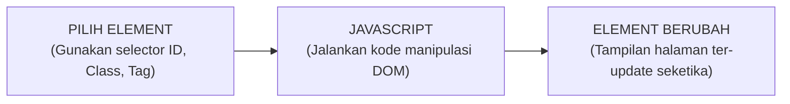
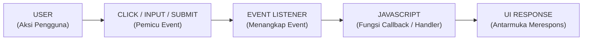
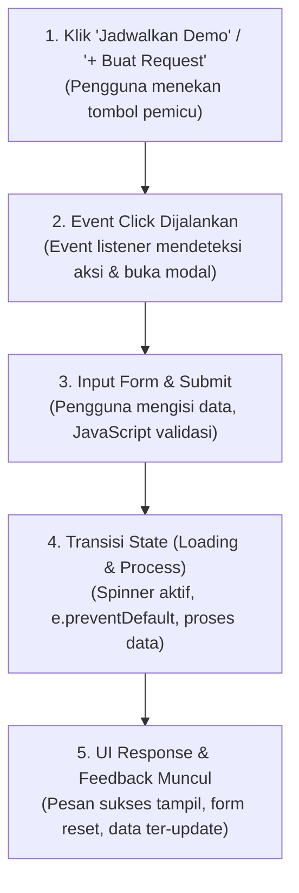
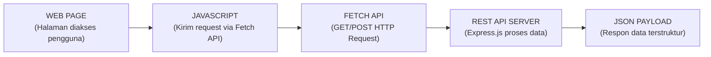
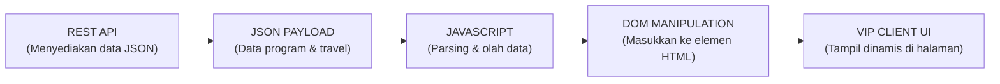

# VIP Bespoke Travel - Client Portal & Travel Planning Dashboard

Repositori resmi kolaborasi pengembangan platform **VIP Bespoke Travel & Luxury Concierge Advisory**, menghadirkan integrasi arsitektur **Model-View-Controller (MVC) PHP**, **Pemrograman Berorientasi Objek (OOP)**, **REST API Express.js dengan Autentikasi JWT & Bcrypt**, antarmuka **Client-Side Rendering (CSR) berbasis TypeScript**, serta **Server-Side Rendering (SSR) PHP**.

---

## 👥 Identitas Pengembang & Anggota Tim

- **Zaidaan Diandra Eka Putra (NIM: 202410370110420)**
  - **Fokus Kontribusi:**
    - **Week 7 (Pertemuan 7):** Perancangan & Implementasi Penuh Arsitektur **Model-View-Controller (MVC)** PHP (`models/`, `controllers/`, `views/`, `index.php`), perancangan dashboard *Quiet Luxury* (Obsidian & Champagne Gold) dengan widget telemetri penerbangan AI privat dan dossier perjalanan VIP.
    - **Week 6 (Pertemuan 6):** Perancangan modul **Pemrograman Berorientasi Objek / OOP** (`BespokeConcierge.php`), landing page dinamis dan interaktif (`latihan1.html`, `latihan1.php`) dengan modal autentikasi VIP terintegrasi.
- **Bagas Dewantara (NIM: 202410370110441)**
  - **Fokus Kontribusi:**
    - **Pertemuan 3 (Week 3):** Implementasi Client-Side DOM Selection & Manipulation (**Task 01 — Select & Change**), penanganan ragam user event interaktif (**Task 02 — Handle User Event**), dan penyusunan alur interaksi terpadu end-to-end (**Task 03 — Build One Complete Interaction**) pada modal booking demo dan modal request perjalanan.
    - **Pertemuan 4 (Week 4):** Implementasi konektivitas REST API asinkronus via Fetch API (**Task 01: Connect to API**), pengolahan data serialisasi JSON, dan penyajian data API secara dinamis (**Task 02: Display API Data**) dengan manajemen state lengkap (*Loading, Success, Error State*).
    - **Week 5 / Base Framework:** Perancangan arsitektur backend Express.js (`server.js`), sistem autentikasi JWT & hash password Bcrypt (`users.json`, `hash-password.js`), frontend CSR berbasis TypeScript (`src/dashboard.ts`, `src/types.ts`), formulir pengajuan perjalanan baru, serta implementasi dasar SSR PHP (`public/dashboard.php`, `public/data-processor.php`).
- **Branch Aktif:** `Bagas-Dewantara-202410370110441` / `Zaidaan-Diandra-Eka-Putra-202410370110420`
- **Repository:** [VIP-Bespoke-Travel (GitHub)](https://github.com/BagasD-Tara/VIP-Bespoke-Travel.git)

---

## 🚀 Fitur & Rincian Implementasi Tugas

### 🌐 1. Pertemuan 3: Web Programming — Client-Side DOM & User Interaction

Implementasi manipulasi elemen antarmuka web di sisi klien (*client-side*) menggunakan JavaScript murni (Vanilla JS) dan TypeScript untuk menghadirkan pengalaman pengguna yang interaktif, responsif, dan bebas hambatan:

#### 🔹 Task 01 — Select & Change
*Tujuan: Menggunakan JavaScript untuk mengambil elemen DOM pada antarmuka web dan mengubah propertinya secara dinamis.*



- **Mekanisme Tiga Langkah:**
  1. **Pilih Element:** Mengambil referensi elemen HTML menggunakan selector JavaScript yang sesuai kebutuhan spesifik.
  2. **JavaScript:** Menjalankan instruksi script untuk mengubah properti elemen (teks, atribut, struktur HTML, maupun kelas CSS).
  3. **Element Berubah:** Perubahan tampilan langsung ter-render pada browser secara instan tanpa perlu me-reload halaman.
- **Ragam Selector yang Diterapkan di Proyek:**
  - **Selector ID (`#id` / `getElementById`):** Memilih elemen unik spesifik pada halaman.
    - `document.getElementById('customer-greeting')` &rarr; Target label sapaan personal klien.
    - `document.getElementById('mobileToggle')` &rarr; Target tombol hamburger menu navigasi mobile.
    - `document.getElementById('demoModal')` &rarr; Target kontainer dialog modal konsultasi VIP.
    - `document.querySelector('#btn-nav')` & `#btn-hero` &rarr; Target tombol call-to-action (CTA).
  - **Selector Class (`.class` / `querySelectorAll`):** Memilih satu atau kumpulan elemen berdasarkan kelas styling.
    - `document.querySelectorAll('[data-open-modal="demo"]')` &rarr; Mengambil seluruh tombol pemicu modal di berbagai seksi halaman.
    - `document.querySelectorAll('.action-card')` &rarr; Mengambil koleksi kartu tugas dan proposal.
    - `document.querySelector('.btn-primary')` &rarr; Tombol aksi utama antarmuka.
  - **Selector Tag (`<tag>`):** Memilih elemen berdasarkan nama tag HTML.
    - `document.querySelector('header')` &rarr; Mengambil elemen header untuk manipulasi scroll navigasi.
    - `document.querySelector('h1')` &rarr; Mengambil elemen heading utama halaman.
- **Bukti Perubahan Properti Elemen pada Kode Proyek (`script.js`, `public/landing_page.html`, `src/dashboard.ts`):**
  - **Mengubah Konten Teks (`textContent`):**
    ```javascript
    // Mengubah sapaan klien secara dinamis berdasarkan data profil
    customerGreetingEl.textContent = `Halo, ${data.customer.name}`;
    // Mengubah label tombol saat proses asinkron berlangsung
    clickedButton.textContent = "Memproses...";
    ```
  - **Memanipulasi Kelas CSS (`classList.add / remove / toggle`):**
    ```javascript
    // Mengubah style navbar saat halaman di-scroll
    header.classList.remove('bg-ink/90');
    header.classList.add('bg-ink', 'shadow-lg');
    // Membuka dan menutup drawer navigasi mobile
    navlinks.classList.toggle('open');
    ```
  - **Mengubah Konten HTML Dinamis (`innerHTML`):**
    ```javascript
    // Mengubah badge status koneksi API secara real-time
    apiStatusContainerEl.innerHTML = `
      <span class="api-badge api-badge-success">
        <span class="pulse-dot pulse-dot-green"></span>
        <span>REST API Terhubung</span>
      </span>
    `;
    ```

---

#### 🔹 Task 02 — Handle User Event
*Tujuan: Menambahkan interaksi responsif yang benar-benar dibutuhkan oleh pengguna pada platform VIP Bespoke Travel.*



- **Alur Kerja Event Handling:**
  1. **User:** Pengguna melakukan aksi fisik (klik, ketik, submit formulir, scroll, atau tekan keyboard).
  2. **Click / Input / Submit:** Browser membangkitkan event yang bersesuaian.
  3. **Event Listener:** `addEventListener()` menangkap event target pada elemen yang bersangkutan.
  4. **JavaScript:** Fungsi handler dieksekusi untuk memproses logika bisnis dan sanitasi data.
  5. **UI Response:** Antarmuka web memperbarui tampilan visual dan memberikan umpan balik langsung.
- **4 Kategori Interaksi Esensial yang Diimplementasikan:**
  - **1. Klik Tombol (Click Event):**
    - Tombol Buka/Tutup Modal (`openButtons`, `closeBtn`, `cancelModalBtn`): Membuka dialog formulir VIP dan menyembunyikannya kembali.
    - Tombol Refresh Asinkron (`btnRefreshEl`): Memicu pengambilan ulang data dashboard dari server tanpa reload halaman penuh disertai animasi putaran ikon (*spin animation*).
    - Tombol CTA Demo (`btnNav`, `btnHero`): Memberikan feedback status teks "Memproses..." sebelum mengarahkan ke bagian kontak.
  - **2. Input Formulir & Validasi Real-time (Input & Focus Event):**
    - Input login & request perjalanan: Menangkap perubahan karakter untuk sanitasi data dan validasi kelengkapan form sebelum pengiriman.
    - Autofocus input: Secara otomatis mengarahkan kursor (`firstInput.focus()`) ke field pertama saat dialog modal terbuka untuk kenyamanan pengetikan pengguna.
  - **3. Submit Form Asinkron (Submit Event):**
    - Penanganan `event.preventDefault()` pada formulir reservasi demo (`demoBookingForm`), formulir permohonan perjalanan baru (`newRequestForm`), serta form autentikasi (`loginForm`).
    - Mencegah browser melakukan reload halaman bawaan, lalu mengalihkan proses ke alur loading spinner dan pengiriman data via Fetch API.
  - **4. Klik Menu Responsif Mobile (Toggle Navigasi):**
    - Hamburger navigation button (`mobileToggle`): Menangani klik untuk membuka drawer menu navigasi di layar smartphone (`max-width: 768px`) dan memperbarui atribut aksesibilitas `aria-expanded` (true/false).
    - Auto-close navigasi: Menutup drawer secara otomatis ketika salah satu tautan menu di dalamnya diklik oleh pengguna.
  - **5. Interaksi Pendukung (Scroll Window & Keyboard Escape):**
    - `window.addEventListener('scroll', ...)`: Mendeteksi posisi scroll vertikal layar (> 50px) untuk mengaktifkan efek *glassmorphic elevation* pada sticky navbar.
    - `document.addEventListener('keydown', ...)`: Mendeteksi penekanan tombol keyboard `Escape` (ESC) untuk menutup modal yang sedang aktif secara cepat dan ramah aksesibilitas keyboard (*keyboard-accessible dialog*).

---

#### 🔹 Task 03 — Build One Complete Interaction
*Tujuan: Membangun satu interaksi lengkap ujung-ke-ujung (end-to-end) yang fungsional, bernilai guna nyata, dan mematuhi seluruh checklist evaluasi.*



- **Studi Kasus Alur Interaksi Terpadu yang Dikerjakan:**
  1. **Alur Reservasi Konsultasi Demo Concierge (`public/landing_page.html`):**
     - **Pemicu:** Pengguna mengklik tombol "Jadwalkan Demo" pada hero section atau navbar.
     - **Event & DOM Open:** Modal pop-up aktif seketika (`modal.classList.add('active')`), input nama terfokus secara otomatis.
     - **Eksekusi Logika:** Pengguna mengisi data dan menekan tombol konfirmasi. Script menangkap submit (`e.preventDefault()`), menyembunyikan form, dan mengaktifkan animasi loading state (*900ms simulated processing*).
     - **Hasil pada Halaman:** Loading spinner berganti menjadi pesan sukses reservasi concierge (*Success State*), formulir di-reset, dan pengguna dapat menutup modal melalui tombol selesai, klik backdrop luar, maupun tombol ESC keyboard.
  2. **Alur Pembuatan Permohonan Perjalanan Baru (`src/dashboard.ts` & `public/dashboard.html`):**
     - **Pemicu:** Klien menekan tombol "+ Request Perjalanan" pada dashboard VIP.
     - **Event & Input:** Modal formulir terbuka, klien menginputkan destinasi, tanggal, dan preferensi armada.
     - **Eksekusi Logika:** Submit form divalidasi, tombol beralih ke state disabled dengan teks "Menyimpan..." dan spinner, payload dikirim ke API backend via method `POST /api/requests`.
     - **Hasil pada Halaman:** Floating Toast Notification melayang di sudut layar mengonfirmasi data berhasil disimpan, modal tertutup otomatis, dan daftar request di dashboard diperbarui seketika tanpa me-refresh browser.

- **Checklist Kriteria Keberhasilan (Sesuai Standar Penugasan):**
  - [x] **Event Berjalan:** Seluruh aksi pengguna (klik tombol, input formulir, submit, penekanan keyboard `Escape`, klik overlay luar) terdeteksi secara presisi.
  - [x] **JavaScript Berjalan:** Seluruh kode script dieksekusi dengan bersih dan lancar tanpa meninggalkan error maupun unhandled rejection pada konsol peramban (*0 console errors*).
  - [x] **DOM Berubah:** Komponen halaman mengalami pembaruan dinamis secara mulus (manipulasi konten teks, kelas styling transisi, pergantian view form &rarr; loading &rarr; success, dan penambahan kartu baru).
  - [x] **Interaksi Sesuai Kebutuhan:** Memberikan nilai fungsional yang jelas bagi klien (pendaftaran reservasi concierge pribadi, pengajuan trip VIP terstruktur, dan penutupan modal instan).
  - [x] **Tidak Merusak Halaman:** Seluruh tata letak antarmuka tetap stabil, responsif di seluruh resolusi layar (desktop, tablet, mobile), serta tidak mengganggu fungsi komponen lainnya.

---

### ⚡ 2. Pertemuan 4: Web Programming — Asynchronous JavaScript & REST API Integration

Implementasi komunikasi data asinkronus antara antarmuka web klien (*frontend*) dan penyedia data (*backend server*) menggunakan arsitektur REST API, Fetch API, dan serialisasi data JSON:

#### 🔹 Task 01: Connect to API
*Tujuan: Menghubungkan antarmuka aplikasi VIP Bespoke Travel dengan REST API yang menyediakan data relevan secara asinkronus.*



- **Arsitektur Alur Koneksi API (5 Tahap):**
  1. **Web Page:** Halaman web VIP Bespoke Travel dimuat pada peramban pengguna.
  2. **JavaScript:** Script klien mengeksekusi fungsi asinkronus (`async/await` / `.then()`) untuk meminta data ke endpoint server.
  3. **Fetch API:** Mengirimkan HTTP Request ke URI endpoint target dengan header yang disesuaikan (`Content-Type: application/json`, `Authorization: Bearer <token>`).
  4. **REST API Server:** Server backend (Express.js pada `server.js`) menerima request, memverifikasi token otentikasi klien, membaca basis data mock (`dashboard-data.json`), dan menyiapkan payload respon.
  5. **JSON Data:** Server mengembalikan data terstruktur dalam format JSON dengan status HTTP yang sesuai (200 OK, 201 Created, 401 Unauthorized, dll).
- **Endpoint REST API Terhubung pada Proyek:**
  - `GET /api/dashboard`: Mengambil data agregasi dashboard VIP (profil pelanggan, ringkasan bisnis, item tindakan mendesak, riwayat permohonan perjalanan, jadwal trip mendatang, dan pesan concierge).
  - `POST /api/requests`: Mengirimkan data formulir permohonan perjalanan baru dalam format JSON untuk divalidasi dan disimpan ke basis data persistensi server.
  - `POST /api/auth/login`: Mengirimkan kredensial email dan password dalam format JSON untuk divalidasi dengan algoritma Bcrypt dan menerima token JWT sesi.
  - `GET /api/profile`: Mengambil detail informasi profil pengguna terproteksi token otentikasi Bearer.
- **Contoh Implementasi Kode Koneksi Fetch API (`src/dashboard.ts`):**
  ```javascript
  // Mengirim request GET asinkronus ke server REST API
  const token = sessionStorage.getItem("bespoke_token");
  const headers = { "Content-Type": "application/json" };
  if (token) headers["Authorization"] = `Bearer ${token}`;

  const response = await fetch("/api/dashboard", {
    method: "GET",
    headers: headers
  });

  // Melakukan parsing serialisasi data JSON dari server
  const jsonResult = await response.json();
  ```

---

#### 🔹 Task 02: Display API Data
*Tujuan: Mengambil data JSON dari REST API dan menampilkannya pada antarmuka web platform VIP Bespoke Travel secara dinamis.*



- **Alur Penyajian Data API ke Antarmuka:**
  1. **API:** Server menyediakan data portofolio perjalanan, status tindakan, dan profil akun klien.
  2. **JSON:** API mengirimkan respon dalam struktur data JSON (berupa objek dan array koleksi item).
  3. **JavaScript:** Script klien mem-parsing data JSON (`response.json()`), melakukan validasi ketersediaan field data, dan mengekstraksi properti yang diperlukan.
  4. **DOM:** Data diolah dan dirakit ke dalam struktur dokumen HTML menggunakan template literal, `document.createElement()`, serta manipulasi `innerHTML` dan `textContent`.
  5. **UI Interface:** Komponen visual (kartu status, stepper perjalanan, daftar pesan, badge kategori) ditampilkan pada antarmuka pengguna secara mulus tanpa *page refresh*.
- **Manajemen Siklus Hidup State API (API Lifecycle State Management):**
  Untuk memastikan kenyamanan visual dan *perceived performance* terbaik, aplikasi mengimplementasikan 3 state utama:
  1. **Loading State:** Selagi request API diproses, antarmuka menampilkan komponen *Skeleton Loading* (`.skeleton`) beranimasi dan status badge *“Memproses API...”* dengan spinner berputar.
  2. **Success State:** Setelah data JSON berhasil diterima, skeleton digantikan dengan elemen kartu data riil:
     - **Personal Greeting:** `Halo, ${data.customer.name}` pada header dashboard.
     - **Kartu Perlu Tindakan:** Merender daftar proposal dan tinjauan kebutuhan via `renderActionItems()`.
     - **Daftar Permohonan Perjalanan:** Merender kartu perjalanan via `renderRequests()` lengkap dengan indikator progres 5 tahap (*Diajukan &rarr; Ditinjau &rarr; Proposal &rarr; Disetujui &rarr; Dikonfirmasi*).
     - **Jadwal Trip Mendatang:** Menampilkan kartu destinasi, countdown hari, dan status reservasi via `renderUpcoming()`.
     - **Pesan Concierge:** Menampilkan pesan advisor dan status respons via `renderMessages()`.
  3. **Error State & Tombol Retry:** Jika koneksi API terputus atau server mengembalikan error, antarmuka menampilkan kartu penanganan error komunikatif (`.error-state-card`) dan tombol **“Coba Hubungkan Ulang”** (*Retry Button*) yang memungkinkan pengguna mengulang proses sinkronisasi secara instan tanpa perlu reload browser.
- **Contoh Implementasi Kode Dynamic Rendering (`src/dashboard.ts`):**
  ```typescript
  // Mapping data array JSON menjadi elemen kartu antarmuka dinamis
  function renderRequests(requests: TravelRequest[]): void {
    if (!requestsListEl) return;
    requestsListEl.innerHTML = requests.map(req => `
      <div class="p-5 bg-white rounded-2xl border border-slate-200">
        <div class="flex justify-between items-center mb-3">
          <h4 class="font-bold text-slate-900">${escapeHtml(req.destination)}</h4>
          <span class="badge ${req.statusType === 'warning' ? 'badge-sand' : 'badge-soft-blue'}">
            ${escapeHtml(req.status)}
          </span>
        </div>
        <div class="flex gap-2">
          ${req.steps.map((step, idx) => `
            <div class="flex-1">
              <div class="h-1 rounded-full ${idx <= req.currentStepIndex ? 'bg-amber-600' : 'bg-slate-200'}"></div>
              <span class="text-[11px] text-slate-500">${escapeHtml(step)}</span>
            </div>
          `).join('')}
        </div>
      </div>
    `).join('');
  }
  ```

---

### 🏛️ 3. Arsitektur Model-View-Controller / MVC (Week 7 — Zaidaan Diandra)
Implementasi pola arsitektur MVC murni di sisi server PHP untuk memisahkan data layer, business logic, dan presentation layer secara modular:

- **Front Controller (`index.php`)**:
  - Berfungsi sebagai single entry point aplikasi web PHP MVC.
  - Membaca request HTTP dan memanggil method `DashboardController->index()`.
- **Model (`models/TravelModel.php`)**:
  - Bertanggung jawab atas pengelolaan data persistensi dari `dashboard-data.json`.
  - Mengimplementasikan method query data:
    - `getDashboardData()`: Membaca dan memvalidasi struktur data klien, statistik, dan portofolio perjalanan.
    - `getRequestsByFilter($status)`: Memfilter dossier perjalanan berdasarkan status (`Approved`, `In Review`, `Planning`, `Confirmed`, atau `all`).
    - `getAvailableStatuses()`: Menghitung jumlah per kategori status secara dinamis untuk indikator angka pada filter tab.
- **Controller (`controllers/DashboardController.php`)**:
  - Mengatur alur logika bisnis dan orkestrasi data.
  - Menangani parameter query string (`$_GET['status']`), memvalidasi input, dan memanggil fungsi `TravelModel`.
  - Memproses logika penentuan salam dinamis sesuai waktu server (*Time-of-day greeting*).
  - Merender view melalui method `render()` dengan mem-passing data yang telah disanitasi.
- **View (`views/dashboard-view.php`)**:
  - Antarmuka dashboard VIP berestetika *Quiet Luxury* (palet warna Obsidian `#060a08`, Champagne Gold `#c5a059`, dan Ivory `#fcfbf8`) dengan container terpusat (`max-w-6xl mx-auto`).
  - Dilengkapi fitur:
    - **Widget Telemetri Penerbangan AI Privat:** Pelacakan rute udara *Geneva Cointrin (LSGG) &rarr; Samedan / St. Moritz Engadin (LSZS)* dengan profil elevasi, kecepatan jelajah, dan integrasi transfer apron Maybach.
    - **Copilot Query Dispatch Bar:** Input asisten AI concierge dengan saran cepat dan animasi transmisi terenkripsi ke Geneva Desk.
    - **Filter Tabs Real-time:** Tombol filter interaktif (`All`, `Approved`, `In Review`, `Planning`, `Confirmed`) dengan counter dinamis dari Model.
    - **6 Kartu Portofolio Dossier VIP:** Informasi mendalam mencakup aset transportasi (jet/helikopter/yacht), private advisor, catatan kurasi, estimasi anggaran, dan tautan dossier.
    - **Direct Sovereign Desk & PGP Note:** Kontak langsung concierge dan simulasi pengiriman pesan terenkripsi.

---

### 💎 4. Pemrograman Berorientasi Objek & Landing Page (Week 6 — Zaidaan Diandra)
- **Implementasi OOP (`BespokeConcierge.php`)**:
  - Penerapan prinsip Pemrograman Berorientasi Objek (OOP) dalam PHP: Enkapsulasi properti, metode setter/getter, abstraksi layanan concierge, serta metode pengolahan data paket perjalanan.
- **Landing Page Interaktif (`latihan1.html` & `latihan1.php`)**:
  - Antarmuka beranda dengan tipografi elegan (*EB Garamond* & *DM Sans*) dan navigasi sticky glassmorphic.
  - Seksi kurasi destinasi dunia (Swiss Alps, Monaco, Kyoto, Amalfi Coast, Serengeti, Lapland).
  - Seksi *Fleet & Aviation Showcase* serta penjelasan alur kerja *Bespoke Process*.
  - Modal autentikasi login VIP interaktif yang terhubung langsung ke dashboard.

---

### 🛡️ 5. Autentikasi Pengguna & Keamanan Backend (Week 5 — Bagas Dewantara)
- **Autentikasi JWT & Bcrypt (`server.js`, `hash-password.js`, `users.json`)**:
  - Enkripsi kata sandi menggunakan pustaka `bcryptjs`.
  - Endpoint `POST /api/auth/login` yang menerbitkan token JWT (*JSON Web Token*) dengan masa berlaku 2 jam.
  - Middleware `requireAuth` dengan skema `Bearer Token` untuk melindungi rute privat (`/api/profile`).
- **Halaman Login & Profil Klien (`public/login.html`, `public/profile.html`)**:
  - Validasi formulir login, manajemen token di `localStorage`, dan penampilan profil akun pengguna.

---

### ⚡ 6. Client-Side Rendering TypeScript & Server-Side Rendering PHP (Week 5 — Bagas Dewantara)
- **Dashboard CSR TypeScript (`src/dashboard.ts`, `src/types.ts`, `public/dashboard.html`)**:
  - Pengambilan data asinkron via `fetch('/api/dashboard')`.
  - Tipe state generik `ApiState<T>` (`idle`, `loading`, `success`, `error`), mekanisme retry, dan floating toast notifications.
  - Formulir modal pembuatan request perjalanan baru via `POST /api/requests`.
- **Dashboard SSR PHP (`public/dashboard.php`, `public/data-processor.php`)**:
  - Rendering halaman dashboard di sisi server menggunakan PHP murni.
  - Modul pemrosesan data, kalkulasi durasi, konversi mata uang Rupiah, dan filter pencarian.

---

## 📂 Struktur Direktori Proyek

```plaintext
VIP-BESPOKE-TRAVEL/
├── controllers/              # [Week 7 - Zaidaan] Controller Pola Arsitektur MVC
│   └── DashboardController.php # Logika bisnis, filter status, dispatch view
├── models/                   # [Week 7 - Zaidaan] Model Data Layer Pola Arsitektur MVC
│   └── TravelModel.php       # Abstraksi data JSON, query filtering, agregasi statistik
├── views/                    # [Week 7 - Zaidaan] View Presentation Layer Pola Arsitektur MVC
│   └── dashboard-view.php    # UI Patron Dashboard (Quiet Luxury, AI Telemetry, SSR)
├── src/                      # [Bagas] Source Code Frontend TypeScript
│   ├── dashboard.ts          # Logika frontend CSR, API fetcher, & DOM rendering
│   └── types.ts              # Definisi interface TypeScript & generic state API
├── public/                   # [Bagas] Asset Web Statis & Client Application
│   ├── landing_page.html     # Halaman beranda utama
│   ├── login.html            # Halaman login klien
│   ├── login.js              # Script client-side login & JWT store
│   ├── dashboard.html        # Halaman dashboard VIP (Client-Side Rendering via REST API)
│   ├── dashboard.php         # Halaman dashboard VIP (Server-Side Rendering via PHP)
│   ├── data-processor.php    # Modul pemrosesan data & kalkulasi agregasi PHP
│   ├── dashboard.css         # Styling khusus dashboard VIP
│   ├── dashboard.js          # Bundle JavaScript hasil kompilasi TypeScript
│   ├── profile.html          # Halaman profil akun klien
│   ├── profile.js            # Script client-side profil klien
│   ├── types.js              # Script helper tipe data
│   └── style.css             # Desain global & stylesheet landing page
├── index.php                 # [Week 7 - Zaidaan] Front Controller / Entry Point Aplikasi MVC
├── latihan1.php              # [Week 6 - Zaidaan] Landing Page Dinamis & Integrasi VIP Portal
├── latihan1.html             # [Week 6 - Zaidaan] File Desain Landing Page Quiet Luxury
├── BespokeConcierge.php      # [Week 6 - Zaidaan] Implementasi Class Berorientasi Objek (OOP)
├── script.js                 # [Pertemuan 3 & 4] Script Client-Side DOM Selection, Event Handling, & Fetch API
├── server.js                 # [Bagas] Server Express.js (REST API & Static Server)
├── users.json                # [Bagas] Database mock pengguna & hash password Bcrypt
├── dashboard-data.json       # Mock database bersama (mendukung Express API & PHP MVC)
├── hash-password.js          # [Bagas] Utilitas pembuatan hash password
├── tsconfig.json             # Konfigurasi compiler TypeScript
├── package.json              # Manifest dependensi & scripts NPM
└── README.md                 # Dokumentasi komprehensif proyek kolaborasi
```

---

## 🛠️ Panduan Menjalankan Proyek Secara Lokal

### 1. Prasyarat Sistem
- **PHP 8.x** (tersedia via instalasi PHP mandiri atau XAMPP)
- **Node.js** (versi 18 ke atas) & **NPM**

---

### 2. Menjalankan Aplikasi PHP MVC (Week 7) & Landing Page (Week 6) ⭐
Untuk menjalankan aplikasi MVC PHP yang dikembangkan oleh **Zaidaan Diandra**, buka terminal di direktori proyek dan jalankan:

```bash
php -S localhost:8080
```

Buka peramban (browser) dan akses:
- 🏛️ **Dashboard VIP MVC (Week 7):** [http://localhost:8080/index.php](http://localhost:8080/index.php)
  - Coba filter status perjalanan dengan mengklik tombol filter atau menambahkan query parameter, contoh:
    - [http://localhost:8080/index.php?status=Approved](http://localhost:8080/index.php?status=Approved)
    - [http://localhost:8080/index.php?status=In+Review](http://localhost:8080/index.php?status=In+Review)
    - [http://localhost:8080/index.php?status=Planning](http://localhost:8080/index.php?status=Planning)
    - [http://localhost:8080/index.php?status=Confirmed](http://localhost:8080/index.php?status=Confirmed)
- 💎 **Landing Page & Modul OOP (Week 6):** [http://localhost:8080/latihan1.php](http://localhost:8080/latihan1.php)
- 📄 **Dashboard SSR PHP (Bagas):** [http://localhost:8080/public/dashboard.php](http://localhost:8080/public/dashboard.php)

---

### 3. Menjalankan Server Node.js (REST API & Frontend CSR TypeScript)
Untuk menjalankan backend Express.js dan antarmuka Client-Side Rendering yang dikembangkan oleh **Bagas Dewantara**:

1. **Instal dependensi:**
   ```bash
   npm install
   ```
2. **Kompilasi TypeScript:**
   ```bash
   npm run build:ts
   ```
3. **Pastikan file `.env` tersedia:**
   ```env
   PORT=3000
   JWT_SECRET=rahasia-super-aman-vip-bespoke-travel-2026
   JWT_EXPIRES_IN=2h
   ```
4. **Jalankan server Express:**
   ```bash
   npm start
   ```
5. **Akses melalui browser:**
   - **Landing Page Tim:** [http://localhost:3000](http://localhost:3000)
   - **Login Klien:** [http://localhost:3000/login.html](http://localhost:3000/login.html)
   - **Dashboard (CSR via TypeScript):** [http://localhost:3000/dashboard](http://localhost:3000/dashboard)

---

## 🔐 Kredensial Pengujian Akun

Gunakan akun berikut untuk menguji formulir login pada server Node.js:

| Email | Kata Sandi | Peran |
| :--- | :--- | :--- |
| `dahlah@contoh.com` | `kucing123` | VIP Client |

---

## 📡 Daftar Endpoint REST API

| Method | Endpoint | Proteksi Auth | Deskripsi |
| :--- | :--- | :--- | :--- |
| `POST` | `/api/auth/login` | Publik | Autentikasi user & penerbitan token JWT |
| `GET` | `/api/dashboard` | Opsional / Bearer Token | Mengambil data lengkap portal dashboard |
| `POST` | `/api/requests` | Publik / Bearer Token | Mengajukan request perjalanan baru |
| `GET` | `/api/profile` | Wajib Bearer Token | Mengambil data profil klien terverifikasi |

---

&copy; 2026 VIP Bespoke Travel Concierge Advisory. Hak Cipta Dilindungi Undang-Undang.
